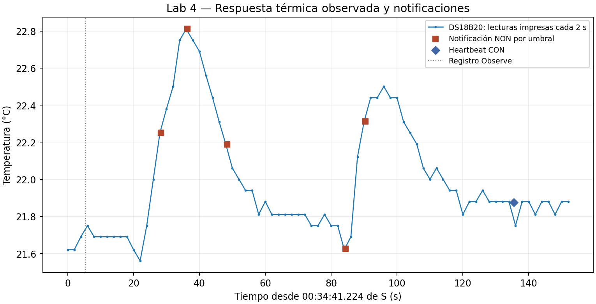

# Registro — Lab 4, DS18B20

**Estado:** ejecución iniciada; DS18B20 reconocido y lectura reciente confirmada en S.
Disponibles según el usuario: DS18B20, protoboards y termómetro.
Firmware C/S y guía preparados; ejecución física de S confirmada por stats.
Logs posteriores confirman ejecución de Lab 4 en C/S y roles iniciales C child,
S leader; ajuste posterior a C leader y S child confirmado. Primer GET CoAP real validado en C/S.

## Sesión y montaje

Fecha/integrantes/lugar: por registrar para este laboratorio.
C/S: ESP32-C6, consola prevista UART/CH343. Sensor S: DS18B20, GPIO18,
alimentación 3V3, 12 bits configurados. Longitud de cable, pull-up, puertos,
versión compilada, distancia y obstáculos: por confirmar con el montaje real.
Referencia disponible: termómetro de cocina de pincho; modelo, exactitud y
resolución no informados. Su idoneidad como referencia no está establecida.

## Primera lectura real en S

[Evidencia original de stats](archivos/01-stats-inicial-S.txt).

| Dato | Resultado |
|---|---|
| Sensor identificado | ds18b20 |
| Última lectura aceptada | 24.00 °C, edad 1 s |
| Contadores | 9 lecturas en 18 s, 0 fallidas (0.0 %), 0 rechazadas |
| Duración de adquisición min/promedio/máximo | 760665 / 762805 / 779901 µs |

La muestra confirma lectura real y funcionamiento inicial. No sustituye los
ensayos de ruido de 60 s ni reposo/tráfico de 120 s. El usuario confirmó montaje
conectado; no se aportó foto para verificar visualmente las conexiones.

## Incidencia posterior: sensor no detectado

Un nuevo bloque, sin identificar C/S, muestra `No 1-Wire slaves connected` desde
arranque, error -19 y Sensor lost a los tres intentos. [Fragmento recibido](archivos/incidencia-1wire-placa-no-identificada.txt).
La lectura inicial correcta de S se mantiene como evidencia de su sesión.
Pendiente identificar si este bloque es C con imagen de sensor o S con pérdida
de conexión; no se asigna causa ni se cuenta como ensayo controlado de desconexión.

## Red: roles iniciales

[Logs C/S](archivos/02-red-roles-iniciales-C-S.txt): C pasa de detached a child
(a 00:00:24.684 de su reloj); S pasa de detached a leader (00:02:26.902 de su
reloj). Estos roles son válidos en Thread; para seguir la guía se propone detener
Thread en ambas y arrancar primero C hasta leader, luego S. No se ha confirmado
aún el resultado de ese ajuste ni la comunicación CoAP. No se restan timestamps
entre placas ni se da por resuelta la incidencia anterior de sensor sin verificar.

## Red ajustada y sensor operativo

[Consolas recibidas](archivos/02-red-C-leader-S-child-y-stats.txt): C confirma
leader y S child. S reporta ML-EID `fd2c:525a:8ff2:2258:a81c:f3d:1e07:2a8b`.
La asignación actual se toma de estas salidas; no se reutilizan etiquetas de
placa/direcciones del Lab 3.

Stats S: 23.94 °C, edad 1 s; 251 lecturas en 501 s, 0 fallidas y 0 rechazadas;
tiempo de adquisición min/promedio/máximo 760660/760764/779901 µs.
Estos contadores acumulados no sustituyen los ensayos controlados de 120 s.
El bloque actual confirma sensor operativo en S; no permite identificar cuál
placa originó la incidencia 1-Wire anterior. GET posterior validado; faltan canal/potencia actuales.

## Primer GET CoAP con sensor real

[Evidencia C/S](archivos/03-GET-inicial-C-S.txt). C solicitó GET CON a la ML-EID
actual de S; la respuesta coincide con el log S: 2.05, 23.94 °C, edad 1 s y
Max-Age 59. El payload `a16174f94dfc` decodifica {t:23.9375 °C} (float16).
El prefijo visual `uart` antes del hex no pertenece a CBOR.

S pasó a router a 00:08:38.173; el GET se atendió a 00:09:39.113 de su reloj.
El origen del GET identifica la ML-EID de C como
`fd2c:525a:8ff2:2258:9966:43d2:59a9:c435`.
Esta muestra verifica frescura en operación normal; no prueba aún el vencimiento
tras desconectar DATA. No contiene un cronometraje del RTT.

## Contrato previsto

`GET /env/temp`, GET+Observe, CBOR {t:float16}, Content-Format 60.
Exactitud declarada del DS18B20 ±0.5 °C entre −10 y 85 °C según fabricante;
el filtro local solo admite −40 ≤ T < 85 y salto ≤5 °C contra lectura menor de
10 s de edad. Lecturas cada 2 s, último valor aceptado conservado ante falla.
Frescura de 60 s desde la lectura; Max-Age disminuye. Sin dato fresco: 5.03,
Max-Age 10 y texto `no fresh reading`; notificación final de error termina Observe.
No se afirma validación experimental de este contrato hasta recibir logs.

## Referencia y offset: discrepancia sin resolver

[Observaciones comunicadas](archivos/referencia-termometro-cocina-observaciones.txt):
termómetro de cocina ≈32 °C frente a DS18B20 ≈24 °C en la comparación inicial;
en otra comprobación el refrigerador indicaba 3 °C y el termómetro de cocina 10 °C.
La diferencia de +7 °C corresponde únicamente a esa observación del refrigerador.
No se conocen igualdad térmica, estabilización, ubicación del sensor interno ni
si el indicador mostraba consigna o temperatura medida. No se atribuye el error
a ninguno de los instrumentos ni se interpreta la discrepancia como calibración.

**No se aplica corrección.** Offset del DS18B20 pendiente de referencia confiable.
Por decisión del usuario se conservan los datos y se continúa con el ruido y los
restantes ensayos. El registro de ruido posterior está documentado a continuación.

## Ruido y paso observado — registro de aproximadamente un minuto

[Log original](archivos/04-ruido-S-log-original.txt), [muestras CSV](ruido-S-muestras.csv)
y [resumen calculado](ruido-S-resumen.json).

| Métrica | Resultado |
|---|---|
| Muestras impresas | 30, cada 2 s |
| Primera / última | 00:30:21.224 / 00:31:19.224 del reloj S |
| Separación entre primera y última | 58 s; 30 muestras a 2 s en un registro de aproximadamente un minuto |
| Mínimo / máximo | 21.50 / 21.62 °C |
| Ruido pico a pico | 0.12 °C |
| Promedio de valores impresos | 21.542 °C |
| Desviación estándar muestral de valores impresos | 0.0321 °C |
| Menor cambio no nulo impreso | 0.06 °C |
| Adquisición min/promedio/máximo | 760664 / 760692 / 760770 µs |
| Contadores de stats | 32 lecturas en 64 s; 0 fallidas (0.0 %), 0 rechazadas |

El paso impreso de 0.06 °C es compatible con el paso nominal de 0.0625 °C a
12 bits y el log a dos decimales; no demuestra esa exactitud. Los estadísticos
se calculan sobre los valores impresos, sin reconstruir decimales originales.
El comando reset previo no aparece en el fragmento, por lo que no se reconstruye
su instante. Stats abarca 32 lecturas y 64 s, frente a 30 muestras visibles;
no se inventan las dos muestras adicionales. La última línea aparece después
del comando log off, compatible con salida concurrente/diferida; se conserva.
No se aplica corrección de offset ni se supone calibrada la referencia.
Esta muestra no sustituye la prueba específica de 120 s en reposo/tráfico.

## Respuesta térmica y Observe — dos subidas observadas

[Log original S](archivos/05-estimulo-S-original.txt),
[consola C](archivos/05-estimulo-C-original.txt),
[77 muestras CSV](estimulo-S-muestras.csv),
[correspondencia Observe C/S](estimulo-observe-C-S.csv).

Las 77 lecturas van de 00:34:41.224 a 00:37:13.224 de S, separadas por 2 s
(152 s entre primera y última). Observe se acepta a 00:34:46.542 con 21.69 °C
impresos (21.6875 °C codificados), edad 1 s y Max-Age 59.

| Resultado | Observación |
|---|---|
| Referencia inicial de la primera subida | 21.69 °C en el registro Observe; valores próximos durante la base previa |
| Primer pico | 22.81 °C a 00:35:17.224 |
| Subida respecto al registro inicial | ≈1.12 °C en valores impresos (1.125 °C entre valores float16 de registro/pico) |
| Media subida con esa referencia | 22.25 °C, primera muestra que la alcanza a 00:35:09.224; la anterior, a 00:35:07.224, es 22.00 °C |
| Tiempo desde inicio del soplido a media subida | No determinado: no se adjuntó marca de inicio/fin del estímulo |
| Recuperación y segunda subida | Tras el primer pico baja a 21.62 °C a 00:36:05.224; después vuelve a subir hasta 22.50 °C a 00:36:17.224 |
| Final de lecturas | 21.88 °C a 00:37:13.224; no se fuerza retorno exacto a la base inicial |
| Notificaciones completas posteriores al registro | 6 recibidas en C: 5 threshold/NON y 1 heartbeat/CON |

La base de 21.69 °C es una referencia de análisis explícita, no una medición
sincronizada con el inicio del soplido. El último mínimo antes de la primera
subida es 21.56 °C a 00:35:03.224, por lo que otros criterios de base cambiarían
la amplitud y el cruce de mitad. No se presenta un tiempo de respuesta físico
a partir de una marca de inicio inferida. El usuario confirmó posteriormente que hubo dos soplidos, sin indicar cuándo
comenzaron/terminaron. [Aclaración](archivos/05-estimulo-aclaracion-usuario.txt).
Se documentan dos soplidos y dos subidas observadas, sin atribuir tiempos
de inicio físicos inferidos de la curva.

| OBS C | Temperatura CBOR °C | Tiempo S | Tipo |
|---|---:|---|---|
| 2 | 21.6875 | 00:34:46.542 | Respuesta inicial al registro; no es notificación posterior |
| 3 | 22.2500 | 00:35:09.571 | NON, threshold 1 |
| 4 | 22.8125 | 00:35:17.580 | NON, threshold 2 |
| 5 | 22.1875 | 00:35:29.593 | NON, threshold 3 |
| 6 | 21.6250 | 00:36:05.630 | NON, threshold 4 |
| 7 | 22.3125 | 00:36:11.637 | NON, threshold 5 |
| 8 | 21.8750 | 00:36:56.683 | CON, heartbeat 1 |

El heartbeat sigue unos 45 s después de la última notificación por umbral.
Cada una de estas seis notificaciones registra 19 B CoAP en S: 114 B en total,
excluidos registro, ACK, retransmisiones y capas inferiores. Son bytes de
aplicación, no una captura de paquetes RF. No hay saltos en OBS=3..8.
El último renglón de S, a 00:37:41.729, es un heartbeat truncado y no tiene
respuesta correspondiente en el bloque C; se conserva, pero no se suma a las
seis notificaciones completas y emparejadas. No se aportó cancelación Observe.

## Plausibilidad — salto rechazado y dato plausible aceptado

[Log original S](archivos/06-inject-S-original.txt).

| Acción | Resultado registrado |
|---|---|
| inject 31.5 | Rejected a 00:45:25.984: salto +9.6 °C frente a lectura reciente de 21.94 °C |
| inject 23 | Aceptado a 00:45:34.536 como `inject: 23.00 C` |
| Observe tras inyección | S registra NON con 23.00 °C a 00:45:35.213, threshold 6 |
| Nueva lectura física | 21.88 °C a 00:45:35.225, 689 ms después de la inyección |
| Observe tras lectura real | S registra NON con 21.88 °C a 00:45:36.215, threshold 7 |
| Stats final | 469 lecturas en 938 s; 0 fallidas, 2 rechazadas; última buena 21.88 °C, edad 1 s |
| Adquisición min/promedio/máximo | 760272 / 760686 / 761385 µs |

El filtro de salto funcionó en la muestra. Un valor artificial plausible pasó
los controles y llegó a la notificación del servidor; no hay bloque C de esta
secuencia para confirmar su recepción. No es una lectura física de 23 °C.
La plausibilidad no demuestra veracidad: una referencia independiente o
redundancia puede detectar discrepancias; autenticación protege procedencia,
pero no vuelve exacto un sensor defectuoso. Seguridad frente a atacantes se
aborda en Lab 6.

El contador muestra dos rechazos acumulados, pero el fragmento solo identifica
uno (31.5). No se infiere que el otro corresponda a `inject 90`: su comando y
mensaje de rechazo por rango aún no se han aportado. Los contadores no son el
ensayo controlado de fallas de 120 s; las inyecciones se analizan por separado.

## Tabla de clase — nuestra fila, parcial

| Sensor | Resolución observada | Ruido 60 s | Offset | Subida / mitad de subida | Notificaciones | Tiempo lectura | Fallas reposo / tráfico | Recuperación |
|---|---|---|---|---|---|---|---|---|
| DS18B20 | 0.06 °C impreso (nominal 0.0625 °C) | 0.12 °C pico a pico; 30 muestras visibles | pendiente: referencia no validada | ≈1.12 °C primer pico; tiempo desde soplido pendiente | 6 (5 NON + 1 CON), dos subidas observadas | 760664/760692/760770 µs min/avg/max | pendiente | pendiente |

Paso nominal a 12 bits: 0.0625 °C, distinto de paso observado y exactitud.
La tabla compartida de clase aún no se ha recibido.

## Disponibilidad y recuperación

| Condición | Evidencia en C | Evidencia en S | Tiempo |
|---|---|---|---|
| Sensor desconectado | pendiente | pendiente | pendiente |
| Sensor reconectado | pendiente | pendiente | pendiente |
| Nodo fuera de red | pendiente | pendiente | pendiente |
| Reinicio de S | pendiente | pendiente | pendiente |

## Auditoría Trustworthiness — DDR §9

| Característica | Evidencia por obtener | Estado |
|---|---|---|
| Integridad ante fallas | referencia, ruido, inyecciones, edad y filtros | pendiente |
| Disponibilidad | GET fresco, vencimiento 5.03, timeout con nodo ausente | pendiente |
| Fiabilidad | failed/reads en reposo y bajo tráfico; meta <5 % ocupado | pendiente |
| Resiliencia | reconexión sensor, unión y recuperación tras reset | pendiente |
| Seguridad operativa | diseño ante 5.03/silencio con plazo y estado por defecto | por documentar |
| Confidencialidad e integridad frente a atacantes | controles de seguridad | → Lab 6 |
| Cumplimiento | contratos y trazabilidad; sin afirmar certificación | por documentar |

DDR §4: PED magnitud física, SCD sensor/filtros, ASD servicio/frescura.
DDR §5: respuestas; §6: detección sensor ≤60 s y fallas ocupadas <5 %,
contrastadas con resultados reales; §7 seguridad; §8 fila Trustworthiness,
Labs Addressed = Lab 4; §9 auditoría con evidencia y brechas.
Resumen para Edwin: se redactará al medir ambos modos de falla.

## Progreso

- [x] Analizar guía y SOP del curso; fijar origen y adaptaciones.
- [x] Preparar firmware DS18B20 S y cliente C, herramientas y guía.
- [x] Montaje conectado según el usuario; DS18B20 reconocido y lectura real confirmada en S.
- [x] Ruido y paso impreso documentados con 30 muestras visibles y stats.
- [x] Curva térmica y seis notificaciones emparejadas en C/S documentadas.
- [x] Dos soplidos confirmados por el usuario.
- [ ] Inicio/fin de los soplidos no medidos; tiempo de media subida desde el estímulo no determinado.
- [x] Inyección 31.5 rechazada por salto y 23 aceptada/notificada en S.
- [ ] Aportar rechazo por rango de inject 90; offset pendiente de referencia confiable.
- [ ] Sensor perdido y nodo inaccesible cronometrados.
- [ ] Reposo/tráfico, recuperación y reset documentados.
- [ ] Comparación de clase e informe completados.
- [ ] Cierre físico de la sesión confirmado.
